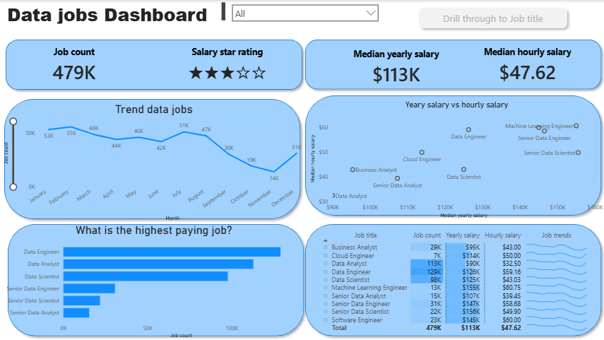

## Data jobs Dashboard w/ Power Bi

## Introduction
This dashboard was created to solve a common problem: information about the data job market is scattered and hasrd to grasp. Using a real world dataset of 2024 data science job postings (including titles, salaries, and locations), this project provides a single, easy-to-use interface to exlpore market trends and compensation.

## Skills showcased

- **Data transformation (ETL) with Power Query:**
Cleaned, shaped and prepared the raw data for analysis by handling blanks,  changing data types, and creating new columns.

- **Implicit Measures:** Fomrulates measures to drive key insights and KPIs like 'Median Yearly Salary' and 'Job Count'.

- **Core Charts:** Utilized Column, Bar, Line as well as Area charts to compare job counts and track trends over time.

- **Geospatial Analysis:** Leveraged **Map charts** to visualize the global distribution of jobs.

- **KPI Indicators and Tables:** Used **Cards** to display key metrics and **Tables** to provide granular, sortable data.

- **Dashboard Design:** Designed an intuitive and visuallt appealing layout, explring both common and uncommon chart types to best tell data story.

- **Interactive Reporting:**
    - **Slicers:** To dynamically filter the report by Job Title.
    - **Buttons and Bookmarks:** To create a seamless navigation experience.
    - **Drill-thorugh:** To navigate from a high-level summary to a contextual, detailed view.

## Dashboard Overview

Interactive Power BI dashboard providing an overview of the data job market. It highlights key metrics such as total job postings, median yearly and hourly salaries, salary ratings, and monthly job posting trends.

It also includes salary comparisons across different job titles and a detailed table to explore job demand and compensation.

